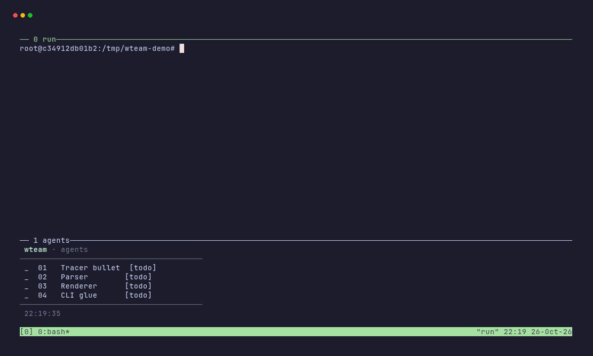

# wteam

[](https://github.com/bcmyguest/wteam/actions/workflows/ci.yml)

Portable worker/reviewer teams for coding agents (Claude Code, Codex, opencode, Cursor).

wteam runs planned tickets through pairs of agents. A worker implements a
ticket, a reviewer passes or fails it, and a passed ticket commits. Agents talk
through append-only mailboxes under `.wteam/`. Documentation site:
<https://bcmyguest.github.io/wteam/>.



## Install

macOS and Linux (including WSL), from the latest GitHub release:

```bash
curl -fsSL https://raw.githubusercontent.com/bcmyguest/wteam/main/install.sh | sh
```

The script picks the static binary for your platform (`x86_64`/`aarch64` Linux
musl, Apple Silicon or Intel macOS), verifies it against `checksums.txt`, and
installs it to `~/.local/bin` (override with `WTEAM_INSTALL_DIR`; pin a release
with `WTEAM_VERSION=v0.1.0`). If an authenticated `gh` is available the script
downloads through it; otherwise it uses curl. From a clone: `sh install.sh`.

From source (any platform with Rust):

```bash
cargo install --git https://github.com/bcmyguest/wteam --locked
```

wteam is not published to crates.io.

The agent skill installs separately: `npx skills add bcmyguest/wteam`.

## Quickstart

```bash
wteam init                            # create .wteam/ and an effort directory
wteam pickup --from .scratch/my-effort
wteam status                          # tickets, agents, pending events
wteam ready                           # tickets whose blockers are done
wteam dispatch 01 --pair 1            # hand ticket 01 to worker.1
wteam dispatch --fill                 # hand every dispatchable ready ticket to an idle pair
wteam submit 01 --summary "Done"      # worker: finished round to review
wteam verdict 01 pass --note "Nit"    # reviewer: pass with a note
```

Every command accepts `--json`. The full walkthrough is in the
[quickstart](https://bcmyguest.github.io/wteam/quickstart/).

## Commands

| Command | Purpose |
|---|---|
| `init` | Create `.wteam/` and an effort directory |
| `pickup` | Import planning output and verify it |
| `status`, `ready` | Show tickets and agents; list ready tickets |
| `dispatch`, `submit`, `verdict`, `block`, `requeue` | Move tickets through review |
| `approve` | Pass a human gate |
| `run` | Drive the orchestrator until nothing is runnable |
| `send`, `inbox`, `wait` | Mail and event waiting |
| `graph` | Team or work graph as Mermaid (`--work`, `--team`) |
| `permissions` | Permission profile translation per CLI |
| `report`, `stop`, `restore` | Stop reports and restoring backed-up files |
| `role` | Print a resolved role prompt |
| `config`, `setup` | In progress; see the docs site |

`wteam <command> --help` lists every flag.

## Running a team

`wteam run` drives the team until nothing is runnable, then prints a stop report.
With `--dispatch auto` (the default) the watcher dispatches ready tickets to idle
pairs itself, and the orchestrator is woken only for blocked tickets and human
gates. With `--dispatch model` the orchestrator dispatches every ticket and gets a
digest of each worker and reviewer event:

```bash
wteam run --pairs 2 --budget-tokens 2000000 --max-turns 200
```

- `--budget-tokens` stops new work once the agents' summed context tokens exceed
  the budget. In-flight turns finish first.
- `--dispatch auto|model` picks who dispatches (default `auto`). `model` also
  spends an orchestrator turn on every dispatch.
- `--max-turns` caps orchestrator turns. Handoff turns count toward it.
- The orchestrator hands off to a new generation when its context passes
  `min(handoff_tokens, 0.75 × context_window)`. The handoff is written to
  `handoffs/orchestrator-<gen>.md`.
- Stop reasons: no ticket runnable or in progress, ready tickets not dispatched,
  `--max-turns` reached, token budget exceeded, `--timeout` reached, or a failed
  orchestrator turn.

Agents self-heal. A turn that ends with a held ticket and no `submit` or `block`
gets one re-prompt, then the ticket is blocked. Transient adapter failures retry
three times with backoff. A turn whose process died is reset on the next command.

## Gates

`Verify:` commands in a ticket, and command nodes (`shape=parallelogram`,
`script=`), run at `submit`. A non-zero exit, or a timeout (600 s by default,
`timeout=` per node), returns the ticket to the worker with the output tail as the finding.
A human gate (`shape=hexagon`) holds a passed ticket until `wteam approve <ticket>`.
A pass path that reaches a reviewer who already passed the round blocks the ticket
as a pass cycle.

## team.dot

A team is a DOT graph. Override the built-in team with `.wteam/team.dot`, or
pass `--team <name|path>`:

```dot
digraph default {
  graph [max_visits=3, handoff_tokens=150000]
  orchestrator [agent="orchestrator"]
  worker       [agent="worker", count="$pairs"]
  reviewer     [agent="reviewer", count="$pairs"]
  orchestrator -> worker   [on=dispatch, kind=broadcast]
  worker -> reviewer       [on=submit, kind=pair]
  reviewer -> worker       [on=fail, kind=pair]
  reviewer -> orchestrator [on=pass, kind=fan-in]
  worker -> orchestrator   [on=blocked, kind=fan-in]
}
```

`max_visits` caps review rounds before a ticket is blocked. Attributes are in
the [reference](https://bcmyguest.github.io/wteam/reference/#team-graph-attributes).

## Agents

Each role is an agent definition, a TOML file with `name`, `cli`, and optional
`model`, `prompt`, `profile`, `context_window` and `extra_args`. Built-ins cover
`planner`, `orchestrator`, `worker` and `reviewer`. Override one with
`.wteam/agents/<name>.toml` or `$WTEAM_CONFIG_DIR/agents/<name>.toml`.
`cli` is `claude`, `codex`, `opencode`, `pi` or `fake` (used by tests); `cursor` is in progress.

Claude agents run with project and local settings only, so user hooks and rules
do not reach them. Set
`WTEAM_CLAUDE_USER_SETTINGS=1` to keep user settings. Role prompts require one
command per shell call.

## Permissions

Profiles are Claude permission rules: `control`, `review`, `edit` and `full`.
wteam translates each one per CLI. Some translations are lossy, for example
Codex cannot deny reads of specific paths. Codex agents may write `.wteam/`, so
`wteam` calls inside its sandbox can update state. The `pi` adapter enforces
nothing (✘ in every row): pi runs tools unrestricted, so use a sandbox. The matrix
and reasons are in the
[permissions guide](https://bcmyguest.github.io/wteam/permissions/).

## Layout

```
.wteam/.gitignore            self-ignoring
.wteam/team.dot              optional team override
.wteam/agents/, profiles/    optional agent and profile overrides
.wteam/<slug>/spec.md
.wteam/<slug>/tickets/NN-name.md
.wteam/<slug>/state.json
.wteam/<slug>/mail/<agent>.md
.wteam/<slug>/reviews/NN.md
.wteam/<slug>/queue.md
.wteam/<slug>/handoffs/, logs/, backup/, worktrees/
```

Module map and sequence diagrams: [architecture](https://bcmyguest.github.io/wteam/architecture/).

## Development

```bash
cargo test                                  # unit + integration tests
cargo clippy --all-targets -- -D warnings   # CI fails on any warning
cargo fmt --check
pre-commit install --install-hooks --hook-type pre-commit --hook-type commit-msg
```

The docs site lives in `site/` (Astro + Starlight):

```bash
cd site && pnpm install && pnpm build
```

The demo GIF (`site/public/demo.gif`) is rendered from `site/demo.tape` with
`vhs` (scripted stand-in agents from `site/demo/setup.sh`); the tape's header
has the Docker command.

Commits follow [Conventional Commits](https://www.conventionalcommits.org)
(`feat:`, `fix:`, `docs:`, …), enforced by a commit-msg hook. The commit type
drives release versioning.

## Releases

Every merge to `main` runs `release.yml`: git-cliff computes the next semver
from the conventional commits since the last tag (`feat` → minor, breaking →
major, else patch), pushes the `vX.Y.Z` tag, and publishes a GitHub release
with generated notes. The committed `Cargo.toml` version is never bumped by
hand; the workflow stamps the tag version in at build time.

## License

Apache-2.0. See [LICENSE](LICENSE).
