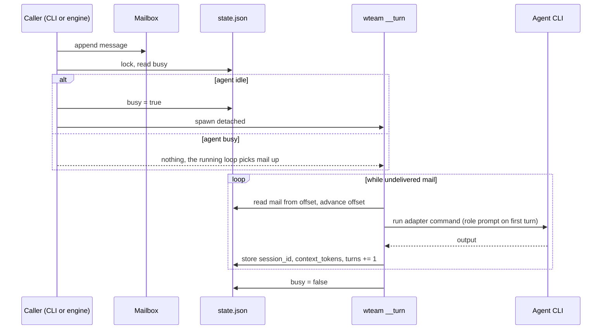
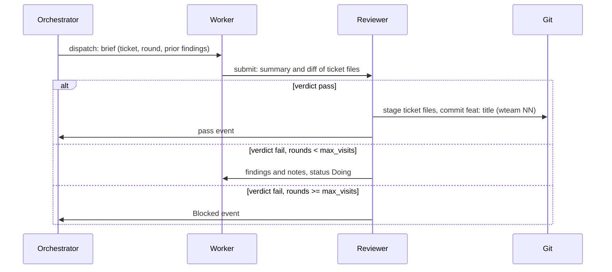
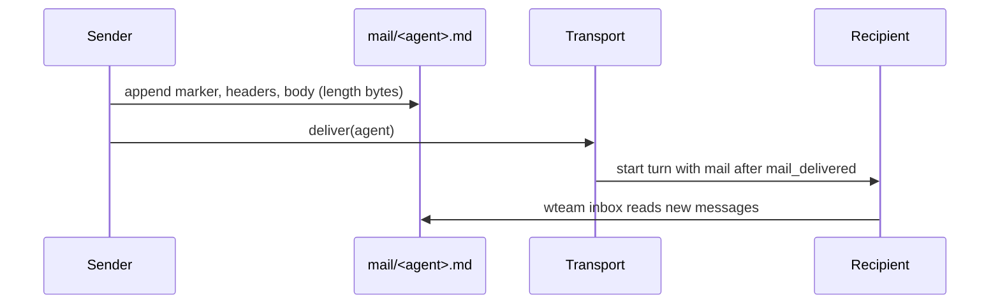

## Module map

The library lives in `src/lib.rs`. `src/main.rs` only parses arguments and prints.

| Module | Role |
|---|---|
| `cli.rs` | Argument parsing and dispatch |
| `commands/` | One file per subcommand group; each returns an `Out` (text and JSON) |
| `engine.rs` | Ticket lifecycle: dispatch, submit, verdict, block |
| `work.rs` | Ticket files, readiness and the work graph |
| `mailbox.rs` | Append-only mail format and parser |
| `state.rs` | `state.json`; written only through `state::with_state` |
| `paths.rs` | Every on-disk path under `.wteam/` |
| `adapters/` | Per-CLI command builders (Claude Code, Codex, opencode, pi, fake) |
| `permissions/` | Profile translation per CLI |
| `team/` | DOT team-graph parser |
| `transport/` | How a delivered mail starts a turn; self-healing and retries in `resume.rs` |
| `watcher.rs` | The `run` loop: orchestrator turns, handoff, budget, stop reasons |
| `backup.rs` | Restore points for files a run applies |
| `worktree.rs` | Isolated worktrees (in progress) |

## Turn lifecycle

On adapter failure (non-zero exit or unparsable output), the turn logs the error,
mails the orchestrator and, if the agent holds a ticket, marks that ticket `Blocked`.

## Ticket lifecycle

## Mailbox delivery

`mail_delivered` is the byte offset already handed to the agent in a turn
prompt. `mail_read` is what `wteam inbox` already showed.
