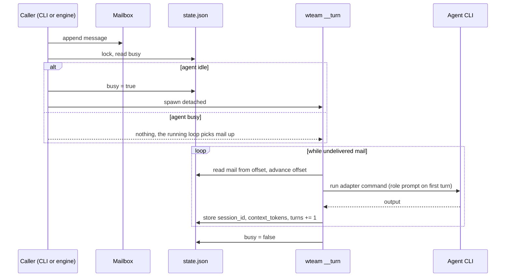
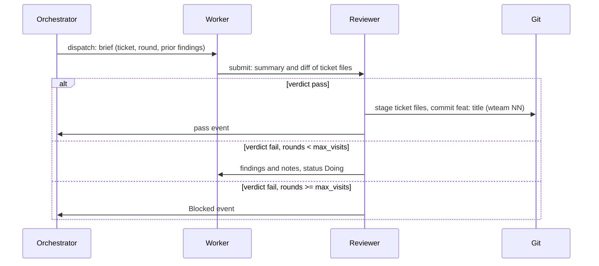
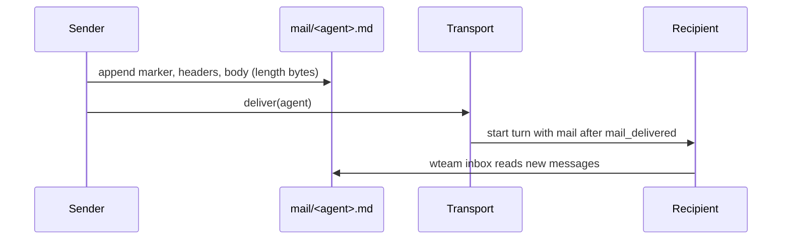

## Module map

The library lives in `src/lib.rs`. `src/main.rs` only parses arguments and prints.

| Module | Role |
|---|---|
| `cli.rs` | Argument parsing and dispatch |
| `commands/` | One file per subcommand group; each returns an `Out` (text and JSON) |
| `engine.rs` | Ticket lifecycle: dispatch, submit, verdict, block |
| `work.rs` | Ticket files, readiness and the work graph |
| `mailbox.rs` | Append-only mail format and parser |
| `state.rs` | `state.json`; written only through `state::with_state` |
| `paths.rs` | Every on-disk path under `.wteam/` |
| `adapters/` | Per-CLI command builders (Claude Code, Codex, opencode, pi, cursor, fake) |
| `permissions/` | Profile translation per CLI |
| `team/` | DOT team-graph parser |
| `transport/` | How a delivered mail starts a turn; self-healing and retries in `resume.rs` |
| `watcher.rs` | The `run` loop: orchestrator turns, handoff, budget, stop reasons |
| `backup.rs` | Restore points for files a run applies |
| `worktree.rs` | Isolated worktrees (in progress) |

## Turn lifecycle



On adapter failure (non-zero exit or unparsable output), the turn logs the error,
mails the orchestrator and, if the agent holds a ticket, marks that ticket `Blocked`.

## Agent adapters

Each agent definition names a `cli`. The adapter builds one headless command per
turn (`resume` transport), parses stdout, and stores `session_id`, `context_tokens`
and assistant text in `state.json`. Turn output is also written to
`.wteam/<slug>/logs/<agent>-<turn>.log` (stdout and stderr concatenated).

| `cli` | Command (summary) | Session resume |
|---|---|---|
| `claude` | `claude -p … --output-format stream-json` | `--resume <id>` |
| `codex` | `codex exec --json …` | `--resume <id>` |
| `opencode` | `opencode run --format json …` | `-s <id>` |
| `pi` | `pi --mode json …` | `--session <id>` |
| `cursor` | Cursor `agent` (in progress) | per adapter |
| `fake` | `sh $WTEAM_FAKE_DIR/<role>.sh` | `session:` line in stdout |

Per-CLI install, config, resume flags and permission quirks:
[Providers](../providers/). Role prompts: Claude, Codex, Pi and Cursor use a
system prompt on the first turn only; OpenCode prepends role text to the user
message. Permissions come from the agent's profile (see [Permissions](../permissions/)).

### Local CLI shims

When `$WTEAM_ROOT/bin/<program>` exists (for example a test wrapper), the turn
runner executes that file instead of searching `PATH`. This does not change
production behavior unless you add a shim under the repo root.

### Maintaining adapter fixtures

Golden JSONL lives under `tests/fixtures/adapters/`. Refresh OpenCode (and
optionally Pi) from a live CLI:

```bash
tests/smoke/capture-adapter-fixtures.sh
# Pi (experimental, needs credentials):
WTEAM_PI_SMOKE=1 tests/smoke/capture-adapter-fixtures.sh
```

Set `WTEAM_OPENCODE_SMOKE_MODEL` for OpenCode (default
`github-copilot/gemini-3.8-flash`). Integration tests replay fixtures via
`$WTEAM_ROOT/bin` wrappers (`tests/adapters_cli_loop.rs`).

## Ticket lifecycle



## Mailbox delivery



`mail_delivered` is the byte offset already handed to the agent in a turn
prompt. `mail_read` is what `wteam inbox` already showed.
