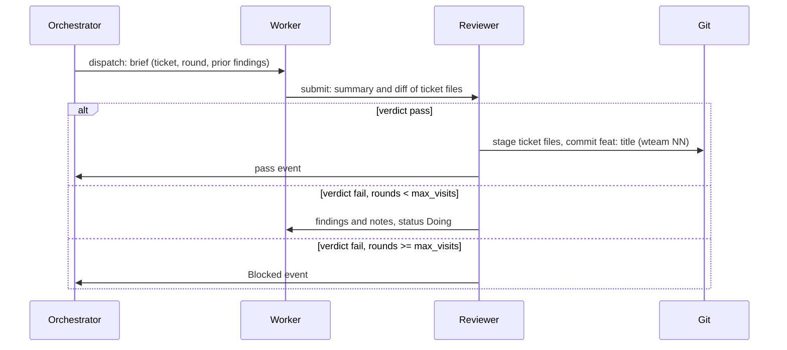
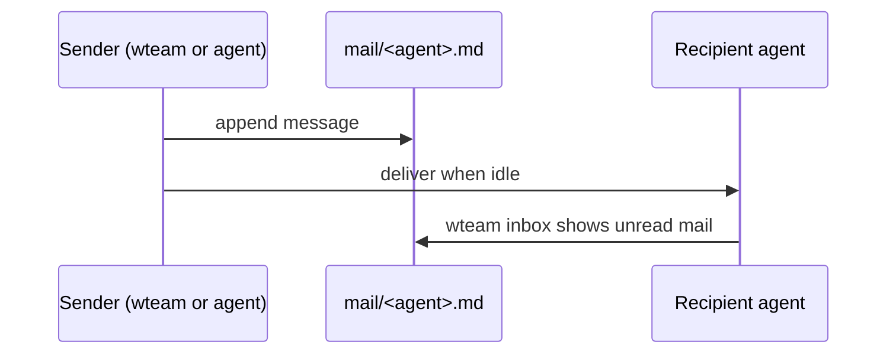

This page is for **running and configuring** wteam. CLI details live in
[Reference](../reference/); per-agent setup in [Providers](../providers/).

## Ticket lifecycle

## Mailboxes

Agents do not share chat history. Each instance has an append-only mailbox under
`.wteam/<slug>/mail/<agent>.md`. Commands append a message and may start an
agent turn if that instance is idle.

`wteam inbox` is what the agent (or you) has already seen; undelivered bytes are
included in the next turn prompt.

## Team graph and mail routing

Who receives mail on **dispatch**, **submit**, **pass**, **fail**, or **blocked**
comes from your **team.dot** graph. Each arrow can set **`kind=`** to `pair`,
`broadcast`, or `fan-in`.

| Kind | Summary |
|---|---|
| [pair](./routing/pair/) | Same pair number (worker.2 → reviewer.2) |
| [broadcast](./routing/broadcast/) | Every instance of that role |
| [fan-in](./routing/fan-in/) | Always `.1` on that role (e.g. orchestrator.1) |

[Mail routing](./routing/) — when to use each kind and copy-paste examples.

## Agent turns

Each mail delivery runs one **headless CLI turn** (Claude, Codex, OpenCode, Pi,
Cursor, …). wteam resumes the same session on later turns when the CLI supports
it, stores token usage in `state.json`, and writes a log at
`.wteam/<slug>/logs/<agent>-<turn>.log`.

If a turn fails or ends without `submit`/`block` while holding a ticket, wteam
retries or blocks the ticket according to [Concepts — Self-healing](../concepts/#self-healing).

Adapter commands and install steps: [Providers](../providers/). Permission mapping:
[Permissions](../permissions/).

## Internals (contributors)

Rust module layout for people hacking on wteam itself:

| Module | Role |
|---|---|
| `cli.rs` | Argument parsing |
| `commands/` | Subcommands |
| `engine.rs` | Dispatch, submit, verdict, block |
| `work.rs` | Tickets and work graph |
| `mailbox.rs` | Mail format |
| `state.rs` | `state.json` |
| `paths.rs` | Paths under `.wteam/` |
| `adapters/` | Per-CLI command builders |
| `permissions/` | Profile translation |
| `team/` | Team graph parser |
| `transport/` | Turn runner and retries |
| `watcher.rs` | `wteam run` loop |
| `backup.rs` | Restore points |
| `worktree.rs` | Worktree isolation (in progress) |

Test shims: if `$WTEAM_ROOT/bin/<program>` exists, turns use that binary instead
of `PATH`. Adapter golden files live under `tests/fixtures/adapters/`; refresh
with `tests/smoke/capture-adapter-fixtures.sh`.
